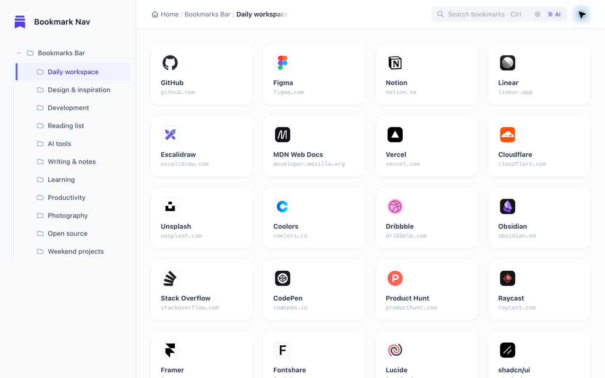
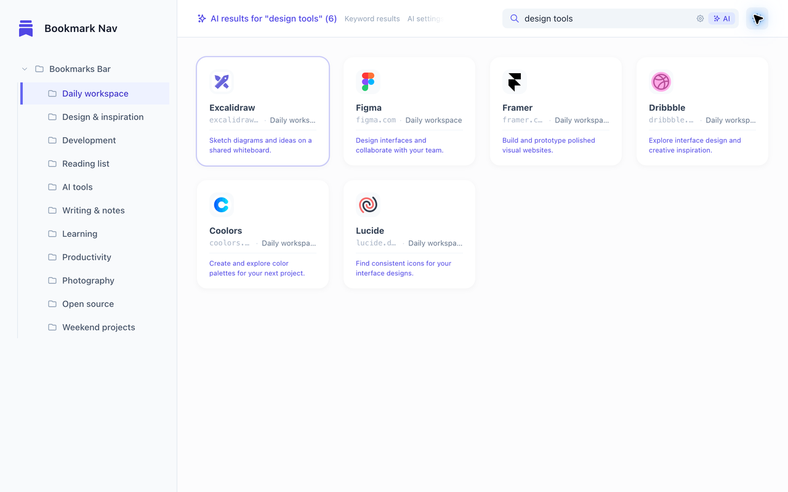
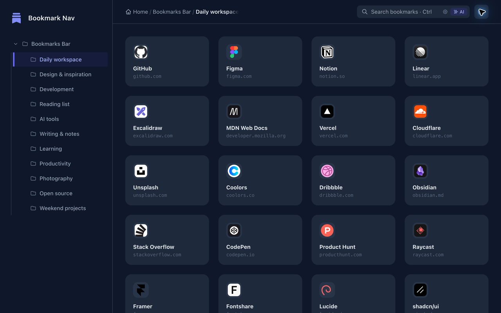
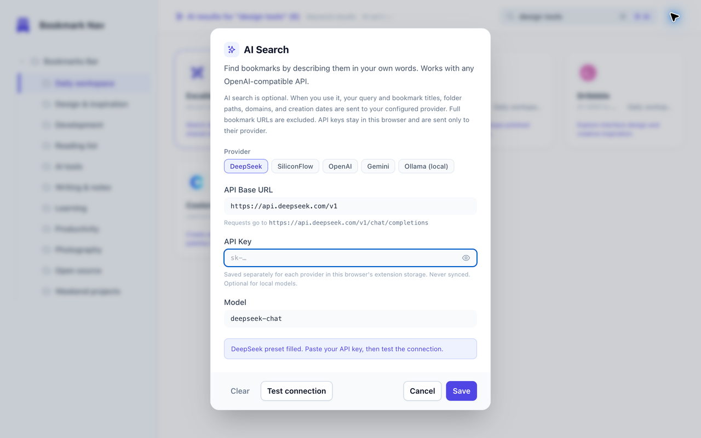

# Bookmark Navigation

[English](./README.md) | [简体中文](./README.zh-CN.md)

A Chrome New Tab extension for browsing, organizing, and finding your bookmarks. Navigate a folder tree, arrange bookmark cards, or describe a site to search with your own AI provider.

[Install from the Chrome Web Store](https://chromewebstore.google.com/detail/mlokjnacolkepjhncmidkjmbkkfoplkc)


*AI-generated promotional artwork. The screenshots below show the actual interface with sample bookmarks; AI results are an illustrative demo.*

## Features

- **Folder navigation:** Expand nested folders, follow breadcrumbs, and reopen new tabs in your last selected folder. Expanded folders are remembered too.
- **Bookmark cards:** Browse titles, domains, and favicons in a responsive grid.
- **Drag and drop:** Reorder bookmarks and folders, move bookmarks between folders, and change folder nesting.
- **Quick management:** Use right-click or a card's menu to open, copy, edit, or delete bookmarks. Create, rename, and delete folders with custom confirmation dialogs for deletion.
- **Instant search:** Filter bookmarks as you type, with folder labels on results.
- **Optional AI search:** Describe a site's purpose or when you saved it. Results include short matching reasons. Supports OpenAI-compatible endpoints, with presets for DeepSeek, SiliconFlow, OpenAI, Gemini, and local Ollama.
- **Three themes:** Light, dark, or follow the system.

## Screenshots

The light-theme overview and AI search view use sample bookmarks, not a personal bookmark collection. The search image demonstrates the result layout and example matching reasons.





<details>
<summary>Dark theme and AI provider settings</summary>





</details>

## AI search setup

1. Open a new tab and click the gear button beside **AI** to open AI search settings.
2. Select a provider preset or enter an OpenAI-compatible **API Base URL**, **Model**, and **API Key**. Keys are optional for local models that do not require authentication.
3. Click **Test connection**, allow Chrome access to the configured API host, then click **Save**. Provider keys are remembered separately by endpoint origin.
4. Enter a description and click **AI**, or press `⌘+Enter` on macOS / `Ctrl+Enter` elsewhere. For example: “a tool for drawing diagrams” or “React tools I saved yesterday.” Press `Esc` or click **Cancel** to stop an active search.

AI receives bookmark creation dates in your browser's local calendar, together with today's and yesterday's dates. Time descriptions help it rank candidates; results depend on the model and the available candidates.

For up to 600 bookmarks, AI evaluates the catalog directly. Larger collections first use AI keyword expansion and local matching, then send at most 120 candidates for ranking. Time-related queries also include up to 30 recent bookmarks. This preselection can omit a matching bookmark in a large collection.

For Ollama, run the selected model locally and allow extension requests with `OLLAMA_ORIGINS="chrome-extension://*"`, then restart Ollama. The settings dialog shows platform-specific guidance.

## Permissions and privacy

- `bookmarks`: Read and manage bookmarks and folders, including drag-and-drop changes.
- `favicon`: Display site icons on bookmark cards.
- `storage`: Save AI settings and API keys in this browser's `chrome.storage.local`; keys are not synced by the extension. Folder and theme preferences are also stored locally.
- Optional HTTP/HTTPS host access: Requested when testing or saving an AI endpoint, for that endpoint's scheme and hostname. Chrome host permissions do not distinguish ports.

Browsing and keyword filtering run locally. When you start an AI search, your search description and candidate **titles, folder paths, domains, and creation dates (`AddedDate`, `YYYY-MM-DD`)** are sent to the endpoint you configured, along with the current local date context. Candidate metadata contains domains instead of full bookmark URLs; URL paths, query strings, and actual bookmark IDs are not sent as candidate fields. The provider's own data handling applies to these requests.

**Clear** in AI settings removes all saved AI endpoints and provider keys, clears the search cache in the current tab, and requests removal of granted AI host permissions. Other open tabs have independent session caches. The button asks for a second click to confirm.

Read the full [Privacy Policy](./PRIVACY.md).

## Installation and development

Install the published version from the [Chrome Web Store](https://chromewebstore.google.com/detail/mlokjnacolkepjhncmidkjmbkkfoplkc), or load a local build:

```bash
git clone https://github.com/atay123/bookmarkNav.git
cd bookmarkNav
npm install
npm run build
```

Open `chrome://extensions/`, enable **Developer mode**, click **Load unpacked**, and select the project root. Open a new tab to use the extension.

```bash
npm run dev                 # Watch and rebuild Tailwind CSS
npm test                    # Node regression tests; no network requests
node --check script.js
node --check ai-search.js
npm run build               # Build minified release CSS
npm run package             # Build and create the extension ZIP in dist/
```

The app uses vanilla JavaScript, Tailwind CSS, and Chrome Extension APIs under Manifest V3. `newtab.html` defines the interface, `script.js` handles navigation and interaction, `ai-search.js` handles AI requests and matching, and `src/input.css` is the CSS source. Author styles there rather than editing generated `style.css`. Regression tests live in `tests/`.

## Interaction and manual checks

- Click a bookmark to open it; use right-click or its menu for more actions.
- Click a folder to select it; its arrow expands or collapses nested folders.
- In search, `Enter` opens the first result. With no keyword matches and AI configured, it starts AI search. `⌘+Enter` / `Ctrl+Enter` starts AI search directly.
- Verify folder restoration and highlighting after reopening a tab; bookmark and folder drag-and-drop; context menus; edit/save and delete confirmation; theme changes; and search/clear behavior without stale results.
- Test AI provider setup, host permission prompts, cancellation, and date-based queries. Automated tests cover recent-candidate retention and local dates across daylight saving transitions; they do not replace an unpacked-extension smoke check.

## What's new in 1.1.6

- AI semantic search with configurable providers, local Ollama support, and matching reasons.
- Bookmark creation dates in AI context, recent-candidate retention, and correct local “yesterday” dates across daylight saving changes.
- Search cache and stale-result handling improvements, regression tests, and refreshed icons and documentation.
- Includes the last-selected-folder restoration introduced in 1.1.5.

## Acknowledgments and license

Thanks to [LINUX DO](https://linux.do/) for support and inspiration. Released under the [MIT License](./LICENSE).
