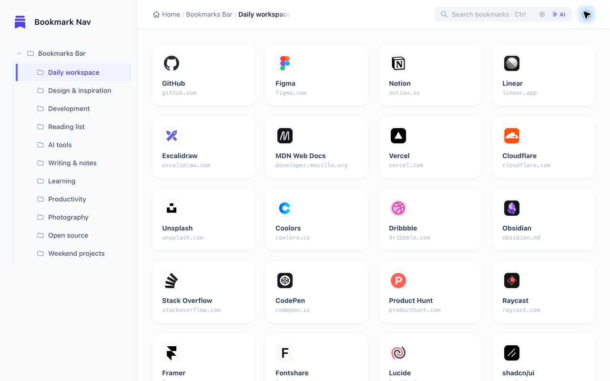
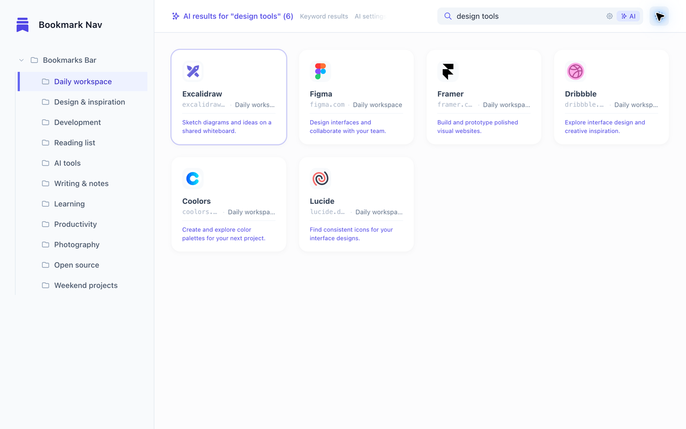
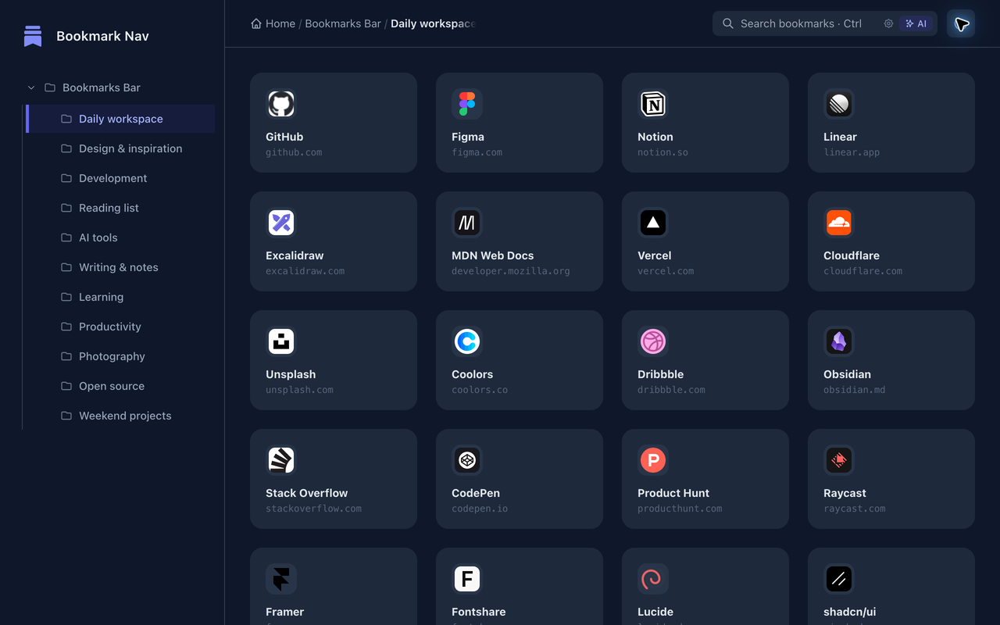
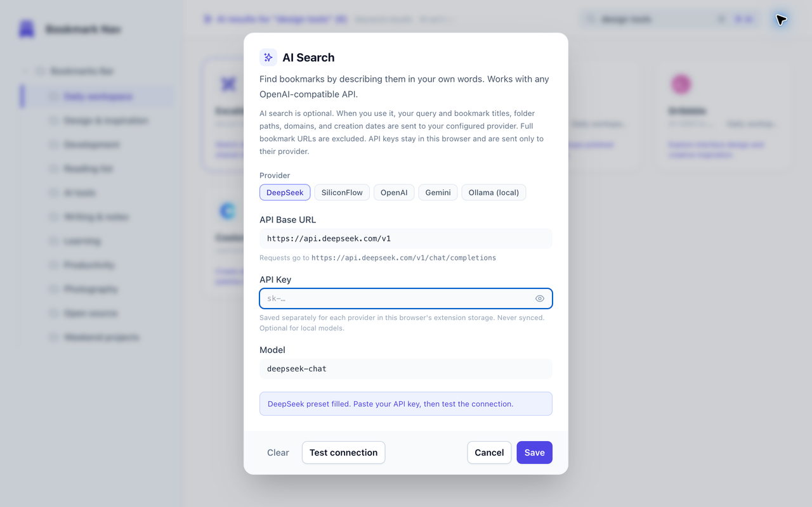

# Bookmark Navigation 书签导航

[English](./README.md) | [简体中文](./README.zh-CN.md)

将 Chrome 新标签页变成书签导航：浏览文件夹树、整理书签卡片，或接入自己的 AI 服务，通过描述找回网站。

[从 Chrome 应用商店安装](https://chromewebstore.google.com/detail/mlokjnacolkepjhncmidkjmbkkfoplkc)


*宣传图由 AI 生成。下方截图展示真实界面，使用示例书签；AI 搜索结果为演示内容。*

## 功能

- **文件夹导航：** 支持多层级文件夹、面包屑导航，打开新标签页时恢复上次选中的文件夹，同时记住目录展开状态。
- **书签卡片：** 在自适应网格中显示标题、域名和站点图标。
- **拖拽整理：** 调整书签与文件夹顺序、跨文件夹移动书签，以及改变文件夹嵌套层级。
- **快捷管理：** 通过右键或卡片菜单打开、复制、编辑和删除书签；新建、重命名或删除文件夹。删除操作使用自定义确认弹窗。
- **即时搜索：** 输入时实时过滤书签，结果显示所属文件夹。
- **可选 AI 搜索：** 描述网站用途或收藏时间，查看带简短匹配理由的结果。支持 OpenAI 兼容接口，提供 DeepSeek、硅基流动、OpenAI、Gemini 和本地 Ollama 预设。
- **三种主题：** 浅色、深色或跟随系统。

## 截图

浅色导航和 AI 搜索截图均使用示例书签，不包含个人书签集合。搜索截图用于展示结果布局及示例匹配理由。





<details>
<summary>深色主题与 AI 服务商设置</summary>





</details>

## 配置 AI 搜索

1. 打开新标签页，点击 **AI** 旁的齿轮按钮，打开 AI 搜索设置。
2. 选择服务商预设，或填写兼容 OpenAI 的 **API Base URL**、**Model** 和 **API Key**。不要求身份验证的本地模型可以不填 Key。
3. 点击 **Test connection**，允许 Chrome 访问所配置的 API 主机，然后点击 **Save**。不同接口来源的 Key 会分别保存。
4. 输入描述后点击 **AI**，或按 macOS 的 `⌘+Enter` / 其他系统的 `Ctrl+Enter`。例如：“可以画流程图的工具”或“昨天收藏的 React 工具”。搜索进行中可按 `Esc` 或点击 **Cancel** 取消。

AI 会收到按浏览器本地日期换算的书签创建日期，以及今天、昨天的日期。时间描述可帮助模型筛选和排序；结果取决于模型和进入筛选的候选书签。

书签不超过 600 条时，直接交给 AI 筛选；超过 600 条时，先由 AI 扩展关键词，在本地匹配，再发送最多 120 个候选进行排序。涉及时间的查询还会加入最多 30 条近期书签。大型书签集合中的匹配项可能因预筛选而遗漏。

使用 Ollama 时，请先在本地运行所选模型，设置 `OLLAMA_ORIGINS="chrome-extension://*"` 以允许扩展请求，再重启 Ollama。设置弹窗提供对应系统的操作提示。

## 权限与隐私

- `bookmarks`：读取和管理书签、文件夹，包括拖拽引起的结构调整。
- `favicon`：在书签卡片上显示站点图标。
- `storage`：将 AI 配置和 API Key 保存在当前浏览器的 `chrome.storage.local` 中，扩展不会同步 Key。文件夹和主题偏好也保存在本地。
- 可选 HTTP/HTTPS 主机访问权限：测试或保存 AI 接口时，按该接口的协议和主机名申请。Chrome 主机权限不区分端口。

浏览书签和关键词过滤在本地运行。主动发起 AI 搜索时，搜索描述、候选书签的**标题、文件夹路径、域名和创建日期（`AddedDate`，`YYYY-MM-DD`）**，以及当前本地日期上下文，会发送到你配置的接口。候选数据使用域名代替完整书签 URL，不将 URL 路径、查询参数或真实书签 ID 作为候选字段发送。服务商自身的数据处理规则适用于这些请求。

AI 设置中的 **Clear** 会删除所有已保存的 AI 接口和服务商 Key、清除当前标签页的搜索缓存，并请求撤销已授予的 AI 主机访问权限。其他已打开的标签页拥有各自独立的会话缓存；需要再次点击按钮确认。

完整说明请参阅[隐私政策](./PRIVACY.md)。

## 安装与开发

从 [Chrome 应用商店](https://chromewebstore.google.com/detail/mlokjnacolkepjhncmidkjmbkkfoplkc)安装已发布版本，或在本地构建：

```bash
git clone https://github.com/atay123/bookmarkNav.git
cd bookmarkNav
npm install
npm run build
```

打开 `chrome://extensions/`，开启 **Developer mode（开发者模式）**，点击 **Load unpacked（加载已解压的扩展程序）**，选择项目根目录，再打开新标签页。

```bash
npm run dev                 # 监听并重新构建 Tailwind CSS
npm test                    # Node 回归测试，不发起网络请求
node --check script.js
node --check ai-search.js
npm run build               # 构建压缩后的发布用 CSS
npm run package             # 构建并在 dist/ 中生成扩展 ZIP
```

项目使用原生 JavaScript、Tailwind CSS 和 Chrome Extension APIs，遵循 Manifest V3。`newtab.html` 定义界面，`script.js` 负责导航和交互，`ai-search.js` 负责 AI 请求和匹配，`src/input.css` 是样式源文件。修改样式时请编辑源文件，不要直接修改生成的 `style.css`。回归测试位于 `tests/`。

## 交互与手动验证

- 点击书签打开网站，通过右键或卡片菜单执行更多操作。
- 点击文件夹切换内容，点击箭头展开或折叠下级目录。
- 搜索框中按 `Enter` 打开首个结果；关键词无结果且已配置 AI 时，发起 AI 搜索。`⌘+Enter` / `Ctrl+Enter` 可直接发起 AI 搜索。
- 检查重新打开标签页后的文件夹恢复与高亮；书签和文件夹拖拽；右键菜单；编辑保存和删除确认；主题切换；搜索与清空搜索时是否出现过期结果。
- 检查 AI 服务商配置、主机授权提示、取消搜索和按日期查询。自动化测试覆盖近期候选保留及夏令时切换时的本地日期，仍需对加载的扩展进行手动冒烟检查。

## 1.1.6 更新

- 新增可配置服务商的 AI 语义搜索，支持本地 Ollama，并显示匹配理由。
- 在 AI 上下文中加入书签创建日期，保留近期候选，并修正夏令时切换时“昨天”的本地日期。
- 改进搜索缓存与过期结果处理，加入回归测试，更新图标和文档。
- 包含 1.1.5 引入的上次所选文件夹恢复功能。

## 鸣谢与许可

感谢 [LINUX DO](https://linux.do/) 社区的支持与启发。项目采用 [MIT License](./LICENSE)。
